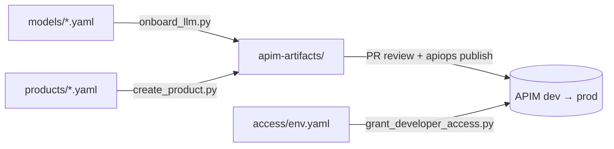

# LLM onboarding with Azure API Management and APIOps

Automates the three steps of exposing a large language model (LLM) to developers through
Azure API Management (APIM):

1. **Onboard an LLM** as an APIM API that calls the model with APIM's managed identity.
2. **Create a product** that bundles onboarded models with a per-developer token allowance.
3. **Grant developers access** with product-scoped subscriptions and APIM-generated keys.

Configuration lives in Git. Changes are reviewed in pull requests, then deployed by the
[APIOps CLI](https://github.com/Azure/apiops-cli) and a small access-provisioning script.

## Repository layout

| Folder | Activity | You edit | Automation |
|---|---|---|---|
| [01-onboard-llm](01-onboard-llm) | Onboard an LLM | `models/*.yaml` | `onboard_llm.py` renders backend, API, policy, and environment overrides |
| [02-create-product](02-create-product) | Create a product | `products/*.yaml` | `create_product.py` renders product, API links, visibility, and token limits |
| [03-publish](03-publish) | Publish to APIM | _generated_ | [3-publish-apim.yml](.github/workflows/3-publish-apim.yml) runs `apiops publish` dev → prod |
| [04-grant-developer-access](04-grant-developer-access) | Grant access | `access/<env>.yaml` | `grant_developer_access.py`, run by [4-grant-developer-access.yml](.github/workflows/4-grant-developer-access.yml) |
| `apim-artifacts/` | — | _generated_ | APIOps artifact tree, committed and reviewed |



## One-time setup

1. **APIM managed identity.** Enable the system-assigned identity on each APIM instance, then
   allow it to call each model resource:

   ```bash
   az deployment group create \
     --resource-group <model-resource-group> \
     --template-file 01-onboard-llm/grant-apim-model-access.bicep \
     --parameters aiAccountName=<openai-account> apimName=<apim-name> apimResourceGroup=<apim-rg>
   ```

2. **Pipeline identity.** Create a Microsoft Entra app registration with
   [federated credentials](https://github.com/Azure/apiops-cli/blob/main/docs/ci-cd/github-actions.md#oidc--federated-credentials)
   for the `dev` and `prod` GitHub environments. Grant it **API Management Service Contributor**
   on each APIM instance, plus **Key Vault Secrets Officer** if you use Key Vault key delivery.

3. **GitHub environments.** Create `dev` and `prod`. Add required reviewers to `prod`.

   | Type | Name | Value |
   |---|---|---|
   | Secret | `AZURE_CLIENT_ID` | Pipeline app registration client ID |
   | Secret | `AZURE_TENANT_ID` | Microsoft Entra tenant ID |
   | Secret | `AZURE_SUBSCRIPTION_ID` | Azure subscription that contains APIM |
   | Variable | `APIM_RESOURCE_GROUP` | APIM resource group |
   | Variable | `APIM_SERVICE_NAME` | APIM instance name |
   | Variable | `ACCESS_KEY_VAULT_URL` | _Optional._ Key Vault for delivering keys |

4. **Application Insights (optional).** The API policy emits token metrics through
   `llm-emit-token-metric`. Connect APIM to Application Insights and enable custom metrics to
   collect them.

5. **Local tools.** Node.js 22 and Python 3.11:

   ```bash
   npm ci
   python -m venv .venv          # Windows: py -3.11 -m venv .venv
   .venv/bin/pip install -r requirements.txt
   ```

   On Windows ARM64, add `--only-binary=cryptography` to the pip command.

## Activity 1: Onboard an LLM

Add a model definition, such as [gpt-4o.yaml](01-onboard-llm/models/gpt-4o.yaml), and render it:

```bash
python 01-onboard-llm/onboard_llm.py
```

Each model becomes:

- **Backend** `llm-<name>-backend`, pointing at `<endpoint>/openai`.
- **API** `llm-<name>`, served at `https://<apim>.azure-api.net/llm/<name>/openai`.
- **Policy** that accepts only the onboarded deployment and swaps the caller's APIM key for
  APIM's managed identity token.
- **Backend URL overrides** for each environment in `03-publish/environments/`.

The API uses `api-key` as its subscription key header, so Azure OpenAI SDKs work unchanged.

## Activity 2: Create a product

Add a product definition, such as [gpt-4o-standard.yaml](02-create-product/products/gpt-4o-standard.yaml), and render it:

```bash
python 02-create-product/create_product.py
```

Each product becomes `llm-<name>`. It requires a subscription, links the listed model APIs,
controls developer-portal visibility, and applies `llm-token-limit` per subscription key.

## Activity 3: Publish

Commit the generated `apim-artifacts/` and `03-publish/environments/` files, then open a pull request.

- **Pull request:** reruns both generators and fails if the committed artifacts are stale.
- **Merge to `main`:** runs `apiops publish --dry-run`, then `apiops publish`, for `dev`, then `prod`.

Preview a publish locally after `az login`:

```bash
npx apiops publish --dry-run \
  --subscription-id <subscription-id> \
  --resource-group <apim-rg> --service-name <apim-name> \
  --source apim-artifacts --overrides 03-publish/environments/configuration.dev.yaml
```

## Activity 4: Grant developer access

Add the developer to the target environment's access file, such as
[dev.yaml](04-grant-developer-access/access/dev.yaml), and merge it. For each grant, the script:

1. Finds the APIM user by ID or email, or creates one. Set `entraObjectId` to link Microsoft Entra ID sign-in.
2. Creates the subscription `<product>--<email-slug>` on the product, or updates its state.
3. With `ACCESS_KEY_VAULT_URL` set, stores each newly activated primary key as the
   Key Vault secret `apim-<subscription>`.

The script never prints or commits keys. Developers can also view their keys on their profile
page in the APIM developer portal.

To suspend or revoke access, set `state: suspended` or `state: cancelled`. Removing a grant does
not revoke access.

Preview changes locally:

```bash
python 04-grant-developer-access/grant_developer_access.py \
  --grants 04-grant-developer-access/access/dev.yaml \
  --subscription-id <subscription-id> --resource-group <apim-rg> --service-name <apim-name> \
  --dry-run
```

## Calling the model as a developer

```python
from openai import AzureOpenAI

client = AzureOpenAI(
    azure_endpoint="https://<apim-name>.azure-api.net/llm/gpt-4o",
    api_key="<APIM subscription key>",
    api_version="2024-10-21",
)
response = client.chat.completions.create(
    model="gpt-4o",
    messages=[{"role": "user", "content": "Hello"}],
)
```

## Notes

- **Reserved prefix.** The generators own artifacts whose names start with `llm-`. They delete
  owned artifacts that no longer appear in the catalog. Publishing does not delete them from APIM;
  run `apiops publish --delete-unmatched` deliberately when retiring a model or product.
- **API coverage.** The bundled OpenAPI spec exposes chat completions only. To expose more
  operations, replace `01-onboard-llm/templates/openai-chat-completions.json` with the
  [official Azure OpenAI spec](https://github.com/Azure/azure-rest-api-specs/blob/main/specification/cognitiveservices/data-plane/OpenAIInference/stable/2024-10-21/inference.json).
- **Visibility groups.** Products are visible to the built-in `developers` group by default.
  Custom groups in `visibleTo` must already exist in APIM.
