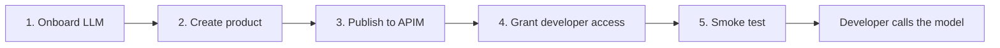

# LLM onboarding with Azure API Management and APIOps

This sample exposes existing Azure OpenAI model deployments through Azure API Management
(APIM), packages them into products, and grants developers product-scoped subscriptions.

Everything is defined in one file, [config.yaml](config.yaml), reviewed in Git, and applied by
[main.py](main.py). APIs and products are deployed with the
[APIOps CLI](https://github.com/Azure/apiops-cli); developer access is created with the APIM SDK.
The sample does not create APIM instances or deploy the underlying models.

## Contents

- [Workflow overview](#workflow-overview)
- [Repository layout](#repository-layout)
- [Prerequisites](#prerequisites)
- [One-time setup](#one-time-setup)
- [Run the activities](#run-the-activities)
- [Call the model as a developer](#call-the-model-as-a-developer)
- [Ongoing operations](#ongoing-operations)
- [Scope and validation](#scope-and-validation)

## Workflow overview

Complete these five activities in order for the initial onboarding:

1. **Onboard an LLM:** generate its API, backend, and routing policy.
2. **Create a product:** associate onboarded APIs with a product and a token allowance.
3. **Publish to APIM:** deploy the generated configuration with APIOps.
4. **Grant developer access:** create developer-owned subscriptions to the published product.
5. **Smoke test:** call each model once through the APIM gateway.



The whole `config.yaml`, including developer grants, is validated before any activity runs,
so an invalid entry stops the run before anything is published.

Once the product is deployed, additional developers can be onboarded by running only
Activity 4 (`--steps access`).

## Repository layout

| File | Purpose |
|---|---|
| [config.yaml](config.yaml) | Models, products, and approved developer access per environment |
| [main.py](main.py) | Runs the activities in order for one environment |
| [onboard_model.py](onboard_model.py) | Activity 1: API, backend, OpenAPI contract, and routing policy for each model |
| [create_product.py](create_product.py) | Activity 2: products, API and group links, and token-limit policy |
| [publish.py](publish.py) | Activity 3: `apiops publish`, always previewed with a dry run first |
| [grant_access.py](grant_access.py) | Activity 4: APIM users, product subscriptions, optional Key Vault key delivery |
| [smoke_test.py](smoke_test.py) | Activity 5: one chat completion per model through the gateway |
| [.github/workflows/deploy.yml](.github/workflows/deploy.yml) | Validates pull requests and deploys merged changes to dev, then prod |

Activities 1 and 2 write APIOps artifacts to `build/<env>/apim-artifacts/`. That folder is
rebuilt by those two steps and is not committed; the publish step uses whatever they last
generated, so run them together (the pipeline always does). `config.yaml` is the file you edit
for models, products, and access; the API contract and policies live in
[onboard_model.py](onboard_model.py) and [create_product.py](create_product.py).

## Prerequisites

- Existing APIM instances and Azure OpenAI model deployments for `dev` and `prod`.
- Network connectivity from APIM to the model endpoints, and from the pipeline runner to
  Azure management endpoints and any Key Vault used for key delivery.
- Permissions to enable APIM's managed identity, assign Azure roles, and configure GitHub environments.
- Python **3.11**, Node.js **22 or later**, npm, and Git for local development.
- Azure CLI for the one-time role assignment and for authenticating local runs.

The checked-in model endpoints and developer details are Contoso placeholders. Replace them
before publishing or granting access. Run all commands from the repository root.

## One-time setup

### 1. Prepare the local environment

Create and activate a Python 3.11 virtual environment, then install the declared dependencies
and the pinned APIOps CLI. Reuse an existing project virtual environment rather than recreating it.

**Windows PowerShell**

```powershell
py -3.11 -m venv .venv
.\.venv\Scripts\Activate.ps1
python -c "import sys; print(sys.prefix != sys.base_prefix, sys.version)"
python -m pip install --upgrade pip
python -m pip install -r requirements.txt
npm ci
```

**Linux or macOS Bash**

```bash
python3.11 -m venv .venv
source .venv/bin/activate
python -c "import sys; print(sys.prefix != sys.base_prefix, sys.version)"
python -m pip install --upgrade pip
python -m pip install -r requirements.txt
npm ci
```

Before installing packages, confirm the interpreter check prints `True` and a Python 3.11
version. On Windows ARM64, add `--only-binary=cryptography` to the requirements installation
command if pip attempts a native build. Keep the environment active for the remaining Python commands.

### 2. Allow APIM to call the model

Enable the system-assigned managed identity on each APIM instance, then grant it
**Cognitive Services OpenAI User** on each model resource:

```bash
az login
az account set --subscription <azure-subscription-id>
apim_principal=$(az apim show -g <apim-rg> -n <apim-name> --query identity.principalId -o tsv)
model_id=$(az cognitiveservices account show -g <model-rg> -n <model-account> --query id -o tsv)
az role assignment create --assignee-object-id "$apim_principal" \
  --assignee-principal-type ServicePrincipal \
  --role "Cognitive Services OpenAI User" --scope "$model_id"
```

Repeat for each environment and model resource. The identity running these commands needs
permission to create role assignments. In PowerShell, assign the variables with
`$apim_principal = az apim show ...` and replace each trailing backslash with a backtick.

### 3. Configure GitHub authentication and environments

Create a Microsoft Entra app registration with
[federated credentials](https://github.com/Azure/apiops-cli/blob/main/docs/ci-cd/github-actions.md#oidc--federated-credentials)
for the repository's `dev` and `prod` GitHub environments. Grant the pipeline identity
**API Management Service Contributor** on the corresponding APIM instances.

Create both GitHub environments and configure these values separately in each:

| Type | Name | Value |
|---|---|---|
| Secret | `AZURE_CLIENT_ID` | Pipeline app registration client ID |
| Secret | `AZURE_TENANT_ID` | Microsoft Entra tenant ID |
| Secret | `AZURE_SUBSCRIPTION_ID` | Azure subscription containing the target APIM instance |
| Variable | `APIM_RESOURCE_GROUP` | Target APIM resource group |
| Variable | `APIM_SERVICE_NAME` | Target APIM instance name |
| Variable | `ACCESS_KEY_VAULT_URL` | Optional vault URL for storing developer subscription keys |

Require pull request reviews on `main` and add required reviewers to the `prod` environment.
Both publishing and access provisioning use these environment settings; neither requires a
client secret when federated authentication is configured.

### 4. Choose how developers retrieve keys

The developer receives an **APIM subscription key**, not an Azure OpenAI resource key.
Choose the delivery method before granting access:

- **Developer portal:** publish and configure the APIM developer portal so developers can
  sign in and retrieve their product subscription keys. Configure the Microsoft Entra identity
  provider separately if developers use Entra sign-in.
- **Key Vault:** set `ACCESS_KEY_VAULT_URL` and grant the access-provisioning identity
  **Key Vault Secrets Officer** on the destination vault. Separately authorize the intended
  developer or application to read its secret; the script does not grant vault read permissions.

The access script does not print key values or write them to Git. On every access run, Key Vault
delivery compares each active subscription's primary key with the vault copy and rewrites it if
it is missing or out of date, so a failed delivery is retried by the next run. It does not rotate keys.

### 5. Configure token metrics

The API policy template includes `llm-emit-token-metric`. To collect those metrics, connect
APIM to Application Insights, enable logging for the generated APIs, and enable custom metrics
with dimensions. Those resources and diagnostic settings are not provisioned by this sample.

If token metrics are not required, remove that element from `API_POLICY` in
[onboard_model.py](onboard_model.py).

## Run the activities

Edit [config.yaml](config.yaml), then run [main.py](main.py) for one environment. With no
`--steps`, it runs all five activities in order; any subset still runs in that order.

```bash
# Generate artifacts only; no Azure calls
python main.py --env dev --steps onboard product

# Preview everything against Azure without changing it
python main.py --env dev --dry-run \
  --subscription-id <azure-subscription-id> --resource-group <apim-rg> --service-name <apim-name>

# Apply all five activities
python main.py --env dev \
  --subscription-id <azure-subscription-id> --resource-group <apim-rg> --service-name <apim-name>
```

The Azure settings can also come from `AZURE_SUBSCRIPTION_ID`, `APIM_RESOURCE_GROUP`,
`APIM_SERVICE_NAME`, and optionally `ACCESS_KEY_VAULT_URL`. If those variables are set,
`main.py` uses them automatically, so clear them before switching instances.

### Activity 1: Onboard an LLM

Add the model under `models` in `config.yaml`: the existing deployment name and the model
resource endpoint for each environment. For every model, this generates:

- **Backend** `llm-<name>-backend`, pointing at `<endpoint>/openai` for the selected environment.
- **API** `llm-<name>`, served at `https://<apim>.azure-api.net/llm/<name>/openai`.
- **Policy** restricting requests to the configured deployment, removing the caller's subscription
  key (header and query string) before forwarding, and authenticating to Azure OpenAI with
  APIM's managed identity.

The API accepts the developer's APIM subscription key in the `api-key` header for compatibility
with the Azure OpenAI client shown below. Model names allow only lowercase letters, digits, and
hyphens; for a deployment such as `gpt-4.1`, use a name like `gpt-4-1`.

### Activity 2: Create a product

Add the product under `products`, listing the model names to include, the visibility groups,
and the token allowance. This generates product `llm-<name>`, its API and group links, and its
token-limit policy. The product requires a subscription. By default, it is visible to the
built-in `developers` group and portal subscription requests require approval. Any custom
visibility groups must already exist in APIM.

The token allowance is **per subscription**, shared by its primary and secondary keys and
the APIs in that product. Issue product-scoped subscriptions as in Activity 4: API-scoped or
all-access subscriptions do not apply product-level policies.

### Activity 3: Publish to APIM

Runs `apiops publish --dry-run` and then `apiops publish` against the generated artifacts.
With `--dry-run`, it stops after the preview. A dry run previews configuration changes; it
does not verify that calls reach the model.

### Activity 4: Grant developer access

Add approved developers under `access.<env>`, using the product name from `products`. The
production access list is empty by default. For each grant, the step:

1. Finds the APIM user by email, or creates one with ID `<email-slug>-<hash>`. The hash keeps
   IDs unique for emails that differ only in punctuation. For a new user, `entraObjectId` can
   associate the account with an Entra identity; it does not configure portal authentication.
2. Finds the developer's subscription to the product by owner, so subscriptions requested in the
   developer portal are reused too. If none exists, creates one with ID
   `llm-<product>--<user-id>`; otherwise changes the existing subscription's state if needed.
3. If Key Vault delivery is configured and the grant is active, makes sure the secret
   `apim-llm-<product>--<user-id>` holds the subscription's current primary key.

If a developer has more than one subscription to the same product, or the new subscription ID
is already used by someone else, the grant fails rather than guessing. The product must
already be published, so run Activity 3 first for a new product. In a dry run, grants for a
product that is not published yet are reported as pending instead of failing.

### Activity 5: Smoke test

For each product, sends one short chat completion to each of its models through the gateway.
Every call must return HTTP 200 with the `x-ratelimit-remaining-tokens` and
`x-quota-remaining-tokens` headers, which proves the product's token policy ran. The calls use
a dedicated release-check subscription per product (`llm-<product>--release-check`, no owner),
created on first use, so they go through the same product policies as developer calls. The
checks consume a few tokens of that subscription's allowance. Suspending the release-check
subscription makes the smoke test fail. Dry runs skip this step.

### Pipeline

[.github/workflows/deploy.yml](.github/workflows/deploy.yml) runs the same `main.py`:

| Event | Behavior |
|---|---|
| Pull request | Validates `config.yaml` (models, products, grants) and generates artifacts for dev and prod; no Azure calls |
| Merge to `main` | Runs all five activities for dev; prod runs only after every dev step, including the smoke test, passes |
| Manual run | Same as a merge; defaults to dry-run mode |

Production approval is enforced by the GitHub environment protection rules configured during setup.
After approval, the prod job refuses to deploy a commit that is no longer the latest on `main`,
so a run that waited for approval cannot overwrite a newer release. To roll back, revert the
change on `main` and let the pipeline deploy the revert.

## Call the model as a developer

Retrieve the product subscription key through the chosen delivery method. Add `openai` to the
client application's dependencies and install it in that application's virtual environment.
Set `APIM_SUBSCRIPTION_KEY` securely in the client environment, then call the APIM endpoint:

```python
import os

from openai import AzureOpenAI

client = AzureOpenAI(
    azure_endpoint="https://<apim-name>.azure-api.net/llm/gpt-4o",
    api_key=os.environ["APIM_SUBSCRIPTION_KEY"],
    api_version="2024-10-21",
)
response = client.chat.completions.create(
    model="gpt-4o",
    messages=[{"role": "user", "content": "Hello"}],
)
print(response.choices[0].message.content)
```

Use the configured deployment name for `model`. The SDK adds the `/openai` path, so the
`azure_endpoint` above intentionally omits that suffix. Developers do not need the backend's key.

## Ongoing operations

### Change or revoke access

Update the grant's `state` in `config.yaml` and run the access step
(`python main.py --env <env> --steps access`) or merge the change:

| State | Effect |
|---|---|
| `active` | Enables the product subscription; the default for a new grant |
| `suspended` | Blocks calls using that subscription |
| `cancelled` | Cancels the subscription and blocks calls |

Removing a grant from `config.yaml` does **not** revoke an existing subscription. Apply the
desired state before removing its record. Key rotation and removal of delivered Key Vault
secrets require a separate process.

### Update or retire models and products

Change `config.yaml` and run `main.py` again (or merge the change); the artifacts are rebuilt
from `config.yaml`. Removing a model or product from `config.yaml` does **not** delete it from APIM.

Treat retirement as a separate, reviewed change: delete the product (with its subscriptions,
including the release-check subscription), then the API, then the backend. Do not use
`apiops publish --delete-unmatched` as routine cleanup: it can delete resources absent from this
artifact tree, including developer subscriptions created by the access step.

## Scope and validation

The bundled API exposes **Azure OpenAI chat completions only**. To add other operations,
use the [official Azure OpenAI specification](https://github.com/Azure/azure-rest-api-specs/blob/main/specification/cognitiveservices/data-plane/OpenAIInference/stable/2024-10-21/inference.json)
as a reference and update both `OPENAPI_SPEC` and `API_POLICY` in
[onboard_model.py](onboard_model.py). Replacing the specification alone is not sufficient for
operations with different routes.

Activities 1-4 were run against a Developer-tier APIM instance with Azure OpenAI `gpt-4o` and
`gpt-4.1` deployments. Validation covered the managed-identity role assignment, APIOps publishing,
user and subscription creation, subscription key retrieval, successful model calls with
token-limit headers, rejected calls to other deployments or without a key, and suspension and
reactivation. Those runs used the earlier per-folder scripts; the refactored `main.py` was
run against the same instance for publishing and access creation, while the API contract and
policies are unchanged.

The GitHub workflows, developer portal sign-in, Key Vault delivery, and Application Insights
token metrics have **not** been validated. The product-scoped smoke test, up-front grant
validation, subscription lookup by owner, Key Vault reconciliation, query-string key removal,
hashed user IDs, and the prod stale-commit check were added afterwards and have not yet been
run against Azure or GitHub. Run the workflows in the client's dev environment before
production use.
