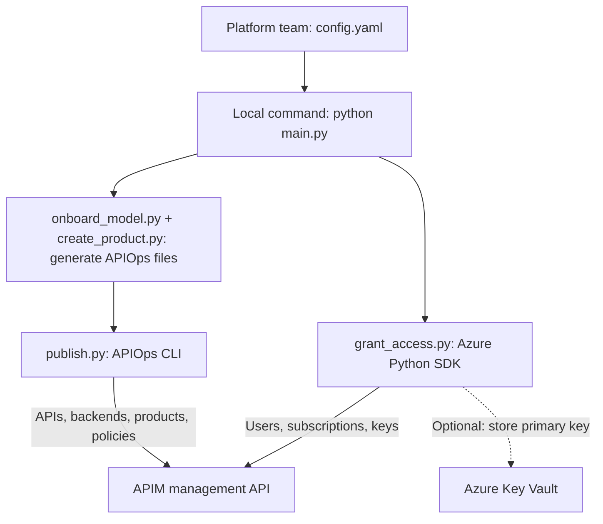
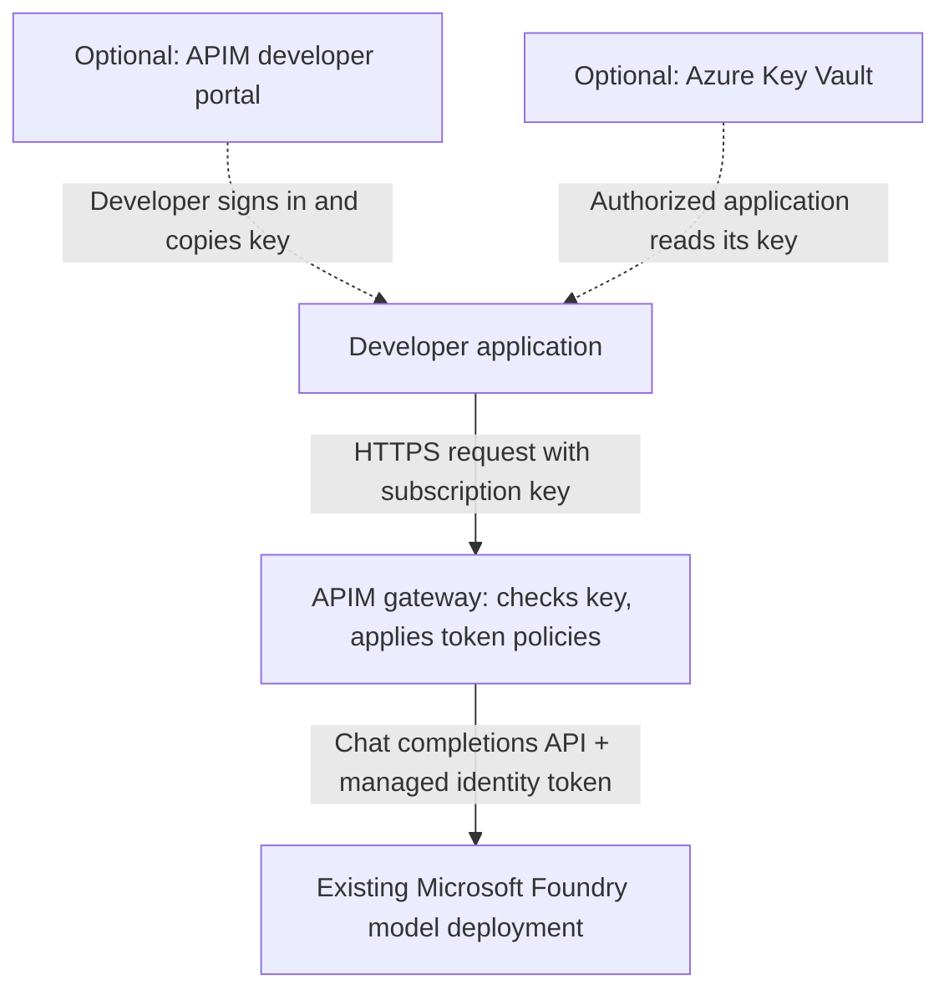
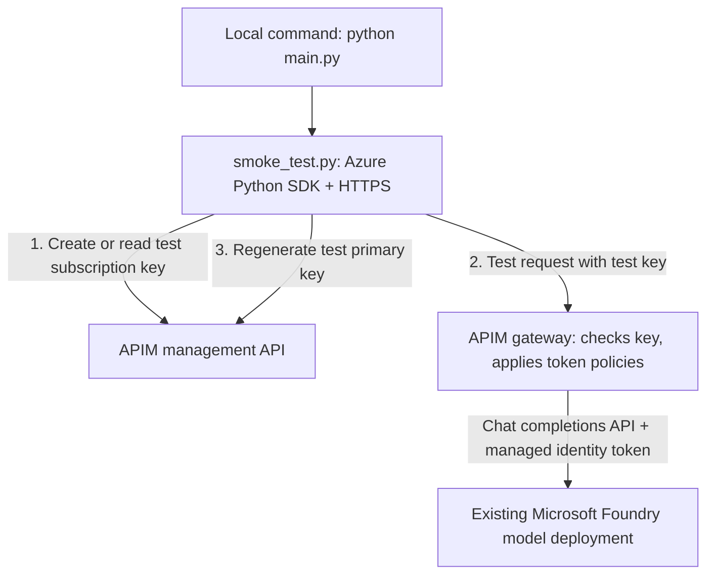

# APIM model onboarding with APIOps and developer access automation via subscription keys

Use the [APIOps command-line interface (CLI)](https://github.com/Azure/apiops-cli) to publish an
existing Microsoft Foundry model deployment as an API in Azure API Management (APIM). This
project generates the files APIOps publishes, then uses the APIM management API to grant approved
developers a subscription and its keys. Developers call the model through APIM; they never need
a Foundry resource key.

The platform team defines the desired model APIs, products, and developer access in
[config.yaml](config.yaml). One local command runs all onboarding and access steps:

1. Generate APIOps configuration files for model APIs, backend connections, products, and policies.
2. Preview and publish those files to APIM with the APIOps CLI.
3. Create or update developer users and product subscriptions through the APIM management API;
   optionally store each primary subscription key in Azure Key Vault.
4. Call each model through APIM to check access and token-policy response headers.

Run the command after changing the configuration. Editing or committing the file does not
deploy changes automatically.

**APIOps publishes the model configuration; the access script grants developer access.** In this
project, APIOps does not create developer users, issue their subscription keys, or deliver keys
to Key Vault. Those steps use the Azure Python software development kits (SDKs).

This proof of concept onboards models that already exist. It does not create APIM instances,
Microsoft Foundry model deployments, networks, identities, or a developer portal. Start with the
[setup and deployment guide](#deploy) to prepare those dependencies.

The sample supports deployments that expose the `/openai/deployments/.../chat/completions`
route. It retains the required endpoint hostnames, SDK identifiers, and Azure role names;
it does not support every Foundry model or API.

## Contents

- [Architecture](#architecture)
- [Components and responsibilities](#components-and-responsibilities)
- [How onboarding runs](#how-onboarding-runs)
- [Deploy](#deploy)
- [Retrieve a key and call the model](#retrieve-a-key-and-call-the-model)
- [Operations](#operations)
- [Before production](#before-production)
- [Validation and limits](#validation-and-limits)

## Architecture

The solution has three paths, each shown in its own diagram. The deployment path configures APIM,
the request path serves developers, and the smoke test path checks the configuration through the
gateway.

The diagrams use these APIM terms. A **product** bundles APIs and policies. A **product
subscription** grants access to the APIs in one product and has primary and secondary keys. These
are API access credentials, not Azure billing subscriptions. In this guide, "subscription key"
means an APIM product subscription key. A **model token** is a unit of text processed by the model;
token allowances limit usage, not a currency budget.

### Deployment path

The platform team runs `main.py` on its own machine to publish the model API and grant developer
access. That machine needs Azure permissions and network access to Azure management endpoints,
plus Key Vault when key delivery is enabled.



### Request path

A developer application sends model requests directly to the APIM gateway with its subscription
key. The deployment machine plays no part in these requests, so it does not need to stay running
for developers to call the model.



### Smoke test path

The same command runs the smoke test last, after publishing and access succeed. You can also run
it alone with `--steps smoke`; dry runs skip it. The test uses its own test subscription, not a
developer's, so the deployment machine also needs network access to the APIM gateway.



### How the paths connect

APIM has two interfaces: a management API that changes configuration and a gateway that serves
requests. The deployment path writes through the management API: APIOps publishes APIs, backends,
products, and policies, and the access script manages users, subscriptions, and keys. The request
and smoke test paths both send requests through the gateway, which applies the configuration the
deployment path published. Neither APIOps nor the access script runs when a developer calls a model.

Subscription keys are the hand-off between the deployment and request paths. The `access` step
creates each developer's product subscription, and APIM generates its keys. The developer then
retrieves a key from Key Vault, if the access step delivered it there, or from a separately
configured developer portal. This project does not configure portal sign-in or grant developer
applications permission to read Key Vault. The smoke test path uses its own test subscription,
so a passing smoke test does not prove that a developer can retrieve or use their key.

Two identities do the work. The **deployment identity**, the operator's Azure CLI sign-in, runs the
deployment and smoke test paths: it changes APIM configuration, reads the test key, and optionally
writes developer keys to Key Vault. In the request and smoke test paths, APIM authenticates to
Microsoft Foundry with its own **managed identity**, an identity whose credentials Azure manages.
A developer application that reads Key Vault needs its own permission to read its secret.

The diagrams describe logical connections, not a private network deployment. If the gateway,
model, or vault uses private endpoints, configure network routes and private Domain Name System
(DNS) resolution so each caller can reach its destination. The deployment machine needs access
to Azure management endpoints for the deployment path, to the gateway for the smoke test path,
and to Key Vault when key delivery is enabled. Developer applications need access to the gateway
and, if they use it, Key Vault. Authentication alone does not make those connections private.

## Components and responsibilities

APIOps publishes configuration. The Python scripts generate its input
files and handle developer access, key delivery, and testing through the APIs listed below.

| Component | Responsibility | Tool or API used |
|---|---|---|
| [config.yaml](config.yaml) | Defines models, products, token allowances, and approved developer access. | Configuration input; no API calls. APIOps receives generated files, not this YAML file. |
| [main.py](main.py) | Validates input, selects the environment, and runs the requested steps in order. | Calls the components below; does not replace the APIOps CLI. |
| [onboard_model.py](onboard_model.py) | Generates each model's API definition, backend connection, and routing policy. | Writes local **APIOps files**; no Azure API calls. |
| [create_product.py](create_product.py) | Generates products, API/group associations, and token policies. | Writes local **APIOps files**; no Azure API calls. |
| [publish.py](publish.py) | Previews and publishes the generated configuration. | Runs **APIOps CLI** through `npx --no-install apiops publish`; APIOps calls the **APIM management API**. |
| [grant_access.py](grant_access.py) | Creates or updates APIM users and product subscriptions; optionally retrieves or rotates primary keys for Key Vault delivery. | **APIM management API** through `azure-mgmt-apimanagement`; **Key Vault secrets API** through `azure-keyvault-secrets`. Does not use APIOps. |
| [smoke_test.py](smoke_test.py) | Manages a test subscription and checks each model through the gateway. | **APIM management API** through `azure-mgmt-apimanagement`; **APIM gateway HTTPS requests** through Python's `urllib.request`. Does not use APIOps. |
| APIM gateway | Checks subscription keys, applies policies, and forwards requests to the model. | **Microsoft Foundry model's chat completions API**, authenticated with a Microsoft Entra token from APIM's managed identity. Does not use APIOps at request time. |

## How onboarding runs

[main.py](main.py) runs five steps in order: `onboard`, `product`, `publish`, `access`, and `smoke`.
Selecting a subset preserves that order. Before any step runs, the script validates model
definitions, products, and the selected environment's endpoints and access grants.

### 1. Generate the model API: onboard

For model `gpt-5-mini`, the `onboard` step generates API `llm-gpt-5-mini` and backend
`llm-gpt-5-mini-backend`. The API exposes `POST /llm/gpt-5-mini/openai/deployments/{deployment-id}/chat/completions`.
The backend points to the selected environment's model endpoint followed by `/openai`.

The API policy accepts an APIM subscription key in the `api-key` header. It rejects a
`subscription-key` query parameter with HTTP 400 and an unconfigured deployment name with
HTTP 404. Before forwarding a permitted request, it removes the caller's `api-key` header
and authenticates to Microsoft Foundry with APIM's system-assigned managed identity.

The `onboard` step writes an OpenAPI document, which describes the API's routes and request
format, plus APIM configuration and policy files in the format APIOps expects. It replaces the
local API and backend folders under `build/<env>/apim-artifacts/`; it does not call APIOps or
change Azure resources.

### 2. Generate products and token policies: product

The `product` step generates APIOps files for each configured product, with its state set to
`published`. These files link model APIs and portal visibility groups to the product and define
its token policy. For example, `gpt-5-mini-standard` becomes product `llm-gpt-5-mini-standard`.
The product becomes available in APIM only after the `publish` step applies those files.

The policy counts usage by APIM subscription ID, so the subscription's two keys and all APIs
in the product share its allowance at a gateway. The sample configures 10,000 tokens per minute
and 5,000,000 tokens per month. API-scoped and all-access subscriptions bypass product policies;
use product-scoped subscriptions when these allowances must apply.

The policy also checks explicit `max_tokens` and `max_completion_tokens` values. It rejects
non-integer values or values above `maxTokensPerRequest`, which is 4,096 in the sample. It
allows omitted or null values and does not insert a default limit. Therefore, this check is
not a guaranteed cap on every request's total token use.

Prompt-token estimation helps reject requests before they reach the model, but concurrent
requests can temporarily exceed the allowance because final usage arrives with model responses.
APIM tracks these counters independently at each gateway. See the
[token-limit policy reference](https://learn.microsoft.com/azure/api-management/llm-token-limit-policy)
for counting, quota, and multi-region behavior.

### 3. Publish the configuration: publish

The `publish` step calls the APIOps CLI to send generated APIs, backends, products, associations,
and policies to the APIM management API. The CLI runs from the locally installed
`@azure-tools/apiops-cli` npm package, whose version the repository pins. It is not a separate
hosted service.

For example, [publish.py](publish.py) previews dev with this command after the
[Azure sign-in and settings](#5-preview-and-deploy-locally) are in place:

```bash
npx --no-install apiops publish --subscription-id "<azure-subscription-id>" --resource-group "<apim-resource-group>" --service-name "<apim-name>" --source build/dev/apim-artifacts --dry-run
```

Unless the overall run uses `--dry-run`, the script then runs the same command without
`--dry-run` and applies changes without pausing for confirmation. Run a separate dry run to
inspect the preview before applying it. Use [main.py](main.py) to run all steps: a
direct APIOps command does not run this project's configuration checks, grant developer access,
deliver keys, or call the model.

Publishing uses the files already in `build/<env>/apim-artifacts/`, so generate both APIs and
products before publishing. The full deployment does this automatically. Removing a definition
from the configuration does not delete its Azure resource: the publisher does not use
`--delete-unmatched`.

### 4. Grant developer access: access

The `access` step uses the Azure Python SDK to call the APIM management API, not the APIOps CLI.
It reads the selected environment's approved grants. For each grant, it:

1. Finds the APIM user by email or creates one. An existing user must be active before the
  script grants active access. If `entraObjectId` is supplied, an existing user must already
  be linked to that Microsoft Entra identity; the script can add the link when creating a user.
2. Finds the user's subscription to the product by owner, including subscriptions requested
   through the portal. It creates a missing subscription or updates its state. APIM generates
   the keys when it creates a subscription. Multiple subscriptions for the same owner and
   product cause an error rather than an arbitrary choice.
3. For an active grant with Key Vault delivery enabled, retrieves the primary key through
   APIM's `listSecrets` operation and stores it through the Key Vault secrets API. The secret
   name is `apim-llm-<product>--<user-id>`, where `<product>` is the configured product name
   and the user ID derives from the email and a short hash. The secret name remains based on
   the grant even when a portal-created subscription has a different ID.

The script does not print keys or save them in the generated APIOps files. Developers retrieve
their keys through the [configured portal or Key Vault](#retrieve-a-key-and-call-the-model).
Creating an APIM user does not configure portal sign-in, and writing a secret does not grant
the developer permission to read it.

The step warns about product subscriptions not represented by a grant; it does not revoke them.
If a grant fails, the run reports the failure and skips the smoke test. Earlier successful
changes remain applied because the script does not roll back automatically.

### 5. Verify gateway access: smoke

The `smoke` step uses the APIM management API to obtain a test subscription key, then sends
an HTTPS request to each model through the APIM gateway. It does not use APIOps. The test requires
HTTP 200 and both `x-ratelimit-remaining-tokens` and `x-quota-remaining-tokens` response headers.
It checks gateway access and the presence of token-policy headers, not model answer quality.

Each product has a test subscription named `llm-<product>--release-check`, which is not
assigned to a developer. The script creates it on first use and attempts to regenerate its
primary key after testing; regeneration failure fails the test. The subscription remains active,
and this step does not rotate its secondary key. These calls do not test the developer's own
subscription, portal sign-in, or Key Vault read permissions.

New keys can take several seconds to reach the gateway. The test makes up to 12 attempts,
waiting five seconds between HTTP 401 responses. Other failures are reported without that
retry. Dry runs skip model calls. A product's `subscriptionsLimit` also counts ownerless
subscriptions, so another ownerless subscription can prevent creation of the test subscription.

## Deploy

Use `dev` for development and `prod` for production. Prepare dev first, then repeat for prod
with its own resources and settings. Use separate APIM instances so dev deployments cannot
change prod configuration. Run one deployment at a time against each APIM instance because
the script does not coordinate concurrent runs.

### 1. Prepare Azure resources

| Dependency | What to prepare |
|---|---|
| APIM | An existing instance on a tier that supports the token policies. The `llm-token-limit` policy does not support the Consumption tier. |
| Microsoft Foundry | An existing model deployment that supports the `/openai/deployments/.../chat/completions` route with Microsoft Entra authentication. Record its deployment name and resource endpoint. |
| Network access | APIM can reach the model; the deployment machine can reach Azure management endpoints and the APIM gateway. Private resources also need routes and private DNS. |
| Key Vault, optional | A vault with Azure role-based access control enabled, reachable from the deployment machine and intended consumers. |
| Developer portal, optional | A published portal with a working sign-in method, if developers will retrieve their keys there. |

You need permission to configure APIM identities and assign Azure roles. Decide whether the
gateway and model endpoints will be public or private before
selecting the APIM tier; the [networking guide](https://learn.microsoft.com/azure/api-management/virtual-network-concepts)
describes the supported combinations. This repository contains no infrastructure deployment template.

### 2. Prepare the repository and tools

Clone this repository, then run all commands from the repository root. Replace every angle-bracket
placeholder in this guide with your own value.

```bash
git clone "<repository-url>" apim-llm-onboarding
cd apim-llm-onboarding
```

Keep configuration containing real model endpoints and developer emails private. Do not push
those values to a public repository. Subscription keys belong in a secret store, not in Git.

Install Python **3.11**, Node.js **22**, Git, and the Azure CLI. Node.js includes npm, which
installs the APIOps CLI. Create a Python virtual environment to keep the project's packages
separate from your system installation. If the project already has one, activate it rather
than recreating it.

**Windows PowerShell**

```powershell
py -3.11 -m venv .venv
.\.venv\Scripts\Activate.ps1
python -c "import sys; print(sys.prefix != sys.base_prefix, sys.version)"
```

**Linux or macOS Bash**

```bash
python3.11 -m venv .venv
source .venv/bin/activate
python -c "import sys; print(sys.prefix != sys.base_prefix, sys.version)"
```

Continue only when the check prints `True` and a Python 3.11 version. With that environment
active, install the pinned dependencies:

```bash
python -m pip install --require-hashes -r requirements.txt
npm ci --ignore-scripts
```

On Windows ARM64, add `--only-binary=cryptography` to the pip command if it attempts a native
build. Keep the virtual environment active for the remaining Python commands. Direct Python
dependencies live in [requirements.in](requirements.in); [requirements.txt](requirements.txt)
pins their resolved versions and hashes. [package-lock.json](package-lock.json) pins the APIOps CLI.

### 3. Define models, products, and approved access

Edit [config.yaml](config.yaml). Its Contoso endpoints and Jane Doe grant are placeholders;
replace them before deploying, or set the relevant access list to `[]` to create no developer grants.

This example connects one model, one product, and one approved developer. The product references
the model's `name`, and the access grant references the product's `name`:

```yaml
models:
  - name: gpt-5-mini
    displayName: GPT-5 mini
    deployment: gpt-5-mini
    endpoints:
      dev: https://contoso-openai-dev.openai.azure.com
      prod: https://contoso-openai-prod.openai.azure.com

products:
  - name: gpt-5-mini-standard
    displayName: GPT-5 mini Standard
    models: [gpt-5-mini]
    approvalRequired: true
    subscriptionsLimit: 1
    visibleTo: [developers]
    limits:
      tokensPerMinute: 10000
      monthlyTokenQuota: 5000000
      maxTokensPerRequest: 4096

access:
  dev:
    - email: jane.doe@contoso.com
      firstName: Jane
      lastName: Doe
      product: gpt-5-mini-standard
      state: active
  prod: []
```

This configuration grants Jane access only in dev. Add an approved grant under `access.prod`
when she needs production access. Neither the configuration nor the generated APIOps files
should contain subscription keys.

| Section | What to set |
|---|---|
| `models` | An internal `name`, display name, existing model `deployment`, and resource endpoint for each environment. |
| `products` | A product name, the model names it includes, visibility groups, and positive integer token allowances. |
| `access.dev` / `access.prod` | Each approved developer's email, first name, last name, product name, and optional state or Entra object ID. |

Model and product names allow lowercase letters, digits, and hyphens. Deployment names may
also contain periods and underscores, so an Azure deployment named `gpt-4.1` can use internal
name `gpt-4-1`. Models, deployment names, and products are shared across environments;
resource endpoints and access grants vary by environment.

Each endpoint must be an HTTPS resource root such as `https://contoso-openai-dev.openai.azure.com`.
Only `.openai.azure.com` endpoints have been tested. The validator also accepts hosts ending in
`.cognitiveservices.azure.com` or `.services.ai.azure.com`, but it is unverified whether those
hosts serve the generated `/openai/deployments/...` route; test them before relying on them.
Do not include `/openai`, a deployment path, or a query string in the endpoint.

Keep `approvalRequired: true`. Portal requests require approval, while grants in the
configuration explicitly authorize the access script to create or activate subscriptions.
The default visibility group is `developers`; custom groups must already exist in APIM.
The anonymous `guests` group is not allowed. Product visibility lets a developer discover the
product; an active product subscription authorizes calls to its APIs.

Preview each configuration change with a local dry run (step 5), then run the deployment
command to apply it. The script applies only the environment selected with `--env`.

### 4. Assign Azure permissions

Enable APIM's system-assigned managed identity in the Azure portal: open the APIM resource,
select **Identity**, set **System assigned** to **On**, and save. Copy its principal/object ID.
On the resource hosting each Foundry model deployment, open **Access control (IAM)** and assign
**Cognitive Services OpenAI User** to that identity. This is the Azure role name required for
the supported API; it permits APIM to call the model without a resource key.

After enabling the managed identity, use these commands to look up both IDs and assign the
role on the resource hosting the Foundry deployment. The `az apim show` command prints the value for
`<apim-principal-id>`, and `az cognitiveservices account show` prints `<model-resource-id>`:

```bash
az login
az account set --subscription "<azure-subscription-id>"
az apim show -g "<apim-resource-group>" -n "<apim-name>" --query identity.principalId -o tsv
az cognitiveservices account show -g "<model-resource-group>" -n "<model-resource-name>" --query id -o tsv
az role assignment create --assignee-object-id "<apim-principal-id>" --assignee-principal-type ServicePrincipal --role "Cognitive Services OpenAI User" --scope "<model-resource-id>"
```

Give your signed-in Azure CLI user the following roles to run the deployment.
Assign each role on the listed resource through **Access control (IAM)**.

| Identity | Role | Scope and reason |
|---|---|---|
| Deployment identity | API Management Service Contributor | Target APIM instance, to publish configuration and manage users, subscriptions, and keys. |
| Deployment identity | Reader | Target APIM resource group, because APIOps reads that group before publishing. |
| Deployment identity, with Key Vault delivery | Key Vault Secrets Officer | Destination vault, to read secret metadata and write subscription keys. |
| Key Vault consumer | Key Vault Secrets User | Its own delivered secret, to retrieve the key without reading other developers' keys. |

The script does not create these role assignments. A secret-scoped consumer assignment can
be added after the first deployment creates the secret. Azure role changes can take time to
propagate, so verify the assigned identity and scope before retrying an authorization failure.

### 5. Preview and deploy locally

Sign in with `az login` and select the intended Azure subscription with `az account set`.
Then set the following values for dev. The allowed endpoint must match the endpoint you put
in the configuration. Keep this allow-list outside that file so a model definition cannot
silently authorize a new destination for APIM's identity token.

**Windows PowerShell**

```powershell
$env:AZURE_SUBSCRIPTION_ID = '<azure-subscription-id>'
$env:APIM_RESOURCE_GROUP = '<apim-resource-group>'
$env:APIM_SERVICE_NAME = '<apim-name>'
$env:ALLOWED_MODEL_ENDPOINTS = 'https://<model-resource>.openai.azure.com'
$env:AZURE_TOKEN_CREDENTIALS = 'AzureCliCredential'
```

**Linux or macOS Bash**

```bash
export AZURE_SUBSCRIPTION_ID='<azure-subscription-id>'
export APIM_RESOURCE_GROUP='<apim-resource-group>'
export APIM_SERVICE_NAME='<apim-name>'
export ALLOWED_MODEL_ENDPOINTS='https://<model-resource>.openai.azure.com'
export AZURE_TOKEN_CREDENTIALS='AzureCliCredential'
```

Use a comma-separated list when an environment has multiple model endpoints. The credential
setting makes both the Python code and the APIOps CLI use your Azure CLI sign-in. Without it,
both use their default Azure credential chains, which can pick up another signed-in identity.

These optional settings control key delivery and gateway access:

| Setting | Purpose |
|---|---|
| `ACCESS_KEY_VAULT_URL` | Vault URL, such as `https://<vault-name>.vault.azure.net/`. Leave unset to skip key delivery. |
| `APIM_GATEWAY_URL` | Gateway base URL for test calls. Leave unset to use the instance's default gateway URL. |

Generate the APIOps files without changing Azure:

```bash
python main.py --env dev --steps onboard product
```

Inspect the generated APIs, backends, and products under `build/dev/apim-artifacts/`. Then preview
both APIOps publishing and developer access:

```bash
python main.py --env dev --dry-run
```

The dry run regenerates local files and reads Azure state. It previews publishing, access
changes, and any key delivery without writing to Azure or calling a model. After reviewing
the preview, run all steps:

```bash
python main.py --env dev
```

The final command generates files, publishes them with APIOps, grants developer access through
the APIM management API, delivers keys if configured, and tests the gateway. For the bundled
configuration, success ends with `Smoke test passed for 1 product/model check(s)`.

Confirm that the access summary reports zero failed grants, then complete the
[developer call](#retrieve-a-key-and-call-the-model) with the developer's own subscription key.
The smoke test uses a separate test key, so it does not prove that the developer can retrieve
or use their key.

You can pass `--subscription-id`, `--resource-group`, `--service-name`, `--allowed-endpoints`,
`--key-vault-url`, or `--gateway-url` instead of setting their corresponding environment variables.
Run `python main.py --help` for all options. Before switching to prod, replace or clear the
Azure settings as well as changing `--env`; that option alone does not select another APIM instance.

### 6. Repeat for prod

After the dev checks pass, set the Azure subscription, APIM instance, and allowed model endpoints
for prod. Set or clear `ACCESS_KEY_VAULT_URL` and `APIM_GATEWAY_URL` so they do not retain dev
values. Confirm the selected Azure CLI account has the required roles on the prod resources.

Review the production grants in `access.prod`, then preview and apply the configuration:

```bash
python main.py --env prod --dry-run
python main.py --env prod
```

Run the second command only after reviewing the preview and obtaining your team's approval.
The script does not enforce an approval gate. Verify a developer's own key after deploying,
just as you did for dev.

## Retrieve a key and call the model

An active product subscription lets a developer call every API in that product. The platform
team must also provide a way to retrieve the key: a configured developer portal or Key Vault.
APIOps is not involved in retrieving a key or making a model request.

### 1. Retrieve the subscription key

**Developer portal:** sign in to the portal URL supplied by the platform team, using the identity
linked to your APIM user. Open the subscriptions section of your profile, find the approved
product subscription, and copy its primary key into your application's secret store. The
platform team must configure and verify portal sign-in separately; this sample does not do so.

**Key Vault:** ask the platform team for the vault name and secret name reported by the `access`
step. Your signed-in identity or application identity needs **Key Vault Secrets User** on that
secret, and the caller needs network access to the vault. Read the current secret version so
the application can pick up a rotated primary key.

For a local test with Key Vault, sign in with `az login` as the authorized consumer and capture
the value in an environment variable. These commands do not print the key.

**Windows PowerShell**

```powershell
$env:APIM_SUBSCRIPTION_KEY = az keyvault secret show --vault-name "<vault-name>" --name "<secret-name>" --query value -o tsv
```

**Linux or macOS Bash**

```bash
export APIM_SUBSCRIPTION_KEY="$(az keyvault secret show --vault-name "<vault-name>" --name "<secret-name>" --query value -o tsv)"
```

For a portal-retrieved key, use your approved secret tooling to set the same
`APIM_SUBSCRIPTION_KEY` variable. Never put the key in source code, logs, or a request URL.

### 2. Call the onboarded model

Add `openai` to your client application's dependency file and install it in that application's
virtual environment. The `AzureOpenAI` client class targets the deployment-based `/openai`
route used by this sample. With `APIM_SUBSCRIPTION_KEY` set, run this code from the same environment:

```python
import os

from openai import AzureOpenAI

client = AzureOpenAI(
    azure_endpoint="https://<apim-name>.azure-api.net/llm/gpt-5-mini",
    api_key=os.environ["APIM_SUBSCRIPTION_KEY"],
    api_version="2024-10-21",
)
response = client.chat.completions.create(
    model="gpt-5-mini",
    messages=[{"role": "user", "content": "Hello"}],
    max_completion_tokens=512,
)
print(response.choices[0].message.content)
```

The endpoint uses the internal model `name`; the `model` argument uses its Azure deployment
name. Both are `gpt-5-mini` in the sample. The OpenAI client library adds `/openai`, so the
endpoint above omits that suffix. Use your configured gateway hostname if it differs from
the default `azure-api.net` address.

The client sends the subscription key in the `api-key` header. APIM checks the key and product
policies, removes that header, and authenticates to Microsoft Foundry with its managed identity.
A successful call prints the model's response. New keys can take several seconds to reach the
gateway; if the first call returns HTTP 401, wait briefly and retry before checking the key and
subscription state.

## Operations

### Change access

Update a grant in [config.yaml](config.yaml), then preview and apply it with the target
environment's Azure settings:

```bash
python main.py --env dev --steps access --dry-run
python main.py --env dev --steps access
```

These commands use the APIM management API and, if configured, the Key Vault secrets API.
They do not run APIOps or republish model APIs. New products must be published before you can
grant access to them. Follow your team's review requirements before applying access changes.

| State | Effect |
|---|---|
| `active` | Enable the subscription. This is the default for a grant. |
| `suspended` | Block calls using either subscription key. |
| `cancelled` | Cancel the subscription and block calls. |

Removing a grant does not revoke access. Apply `suspended` or `cancelled` before removing its
record. Delivered Key Vault secrets are not deleted automatically. Resolve unmanaged-subscription
warnings by adding the approved grants or explicitly revoking the subscriptions.

### Rotate keys

With Key Vault delivery enabled, the access script stores primary keys with a 90-day secret
expiry and a fingerprint tag, a short hash used to detect changes. It compares a hash of the
current APIM primary key with the latest secret version's fingerprint metadata. If the secret
is missing or its fingerprint differs, the script writes the current key again, so another
`access` run can recover from a failed write.

When the stored fingerprint matches the current key and the secret expires in less than 14 days,
the script regenerates the primary key and stores its replacement. The old primary key stops
working as that change reaches the gateway. Consumers need to refresh their key and tolerate
propagation delays; this is not a zero-downtime rotation scheme. The secondary key is unchanged.

Secret expiry does not revoke an APIM subscription key. Rotation uses the APIM management API,
not APIOps. It happens only when the `access` step runs with Key Vault delivery enabled, and the
project does not include a scheduler. Run `python main.py --env dev --steps access` regularly,
or schedule the equivalent command with your organization's job scheduler. Use the intended
environment's Azure settings and credentials, and alert on failures before secrets expire.

### Update or retire APIs

Change the model or product definitions and run all steps to regenerate and publish
them with APIOps. Removing a definition does not delete the corresponding APIM resource.
Retire resources in a separate reviewed change: remove product subscriptions and product
associations before deleting unused products, APIs, and backends.

Avoid `apiops publish --delete-unmatched` for routine cleanup because it can remove resources
managed outside the generated files. To restore an earlier configuration, revert its Git change
and redeploy. A revert updates resources that still have definitions, but it leaves APIs,
backends, products, users, and subscriptions that the reverted change added; retire them as
described above. It also does not restore previously rotated keys or undo unrelated Azure changes.

## Before production

The project does not configure the following controls. Complete them for your environment
before granting production access:

- **Private connectivity:** select an APIM tier that supports the required networking, using the
  table below. Configure private endpoints or virtual network options, private DNS, and
  public-access restrictions on APIM, the Foundry resource, and Key Vault.
- **Model authentication:** disable Foundry resource-key authentication if managed identity
  is the required access method. Restrict model permissions to approved identities. A separate
  user-assigned identity does not isolate APIs from administrators who can change APIM policies.
- **Access boundaries:** suspend the built-in all-access subscription (`master`) unless it is
  needed, using the command below. Review API-scoped subscriptions too, because neither applies
  the product's token policies. The Azure portal's API test console uses `master` by default.
- **Deployment permissions:** **API Management Service Contributor** can also change networking,
  read named values, and delete the instance. Replace it with a custom role on each APIM
  instance, starting from the actions below, and keep **Reader** on the resource group for
  APIOps. Restrict consumers to their own Key Vault secrets.
- **Change approval:** review configuration, code, and dependency changes before deploying.
  Require independent approval for production changes and use a deployment machine that meets
  your organization's security requirements. The script does not enforce these controls.
- **Monitoring:** the API policy includes `llm-emit-token-metric`, but this project does not create
  Application Insights loggers or API diagnostic settings. Configure them and enable custom
  metrics with dimensions using the [token-metric policy guide](https://learn.microsoft.com/azure/api-management/llm-emit-token-metric-policy).
  Mask subscription-key headers and query parameters, and avoid logging prompts or responses
  unless your data policy permits it. Alert on deployment, authentication, and rotation failures.

This table summarizes the [APIM networking options](https://learn.microsoft.com/azure/api-management/virtual-network-concepts)
by tier. Inbound traffic flows from callers to APIM; outbound traffic flows from APIM to the model.

| Tier | Private inbound | Private outbound | Notes |
|---|---|---|---|
| Premium v2 | Virtual network injection or private endpoint | Virtual network injection or integration | Isolates the gateway; injection is set when creating the instance. |
| Premium (classic) | Internal virtual network or private endpoint | Virtual network injection | Isolates the gateway, portal, and management endpoints in internal mode. |
| Standard v2 | Private endpoint | Virtual network integration | The developer portal and management plane remain public. |
| Developer (classic) | Internal virtual network or private endpoint | Virtual network injection | Has no service-level agreement; use it outside production. |
| Basic, Standard (classic) | Private endpoint | None | The model endpoint must remain reachable from APIM without a virtual network. |
| Basic v2, Consumption | None | None | Cannot use these private options. Consumption also lacks the token-limit policy. |

After adding an APIM private endpoint, set public network access to **Disabled**; otherwise
subscription keys still work from the internet.

This command suspends the all-access subscription:

```bash
az rest --method patch --headers "If-Match=*" --url "https://management.azure.com/subscriptions/<azure-subscription-id>/resourceGroups/<apim-resource-group>/providers/Microsoft.ApiManagement/service/<apim-name>/subscriptions/master?api-version=2024-05-01" --body '{"properties":{"state":"suspended"}}'
```

Start a custom deployment role from these actions. This list is untested, so run a dry run and
then a full dev deployment, and add each action reported as denied:

```json
[
  "Microsoft.ApiManagement/service/read",
  "Microsoft.ApiManagement/service/apis/*",
  "Microsoft.ApiManagement/service/backends/*",
  "Microsoft.ApiManagement/service/products/*",
  "Microsoft.ApiManagement/service/groups/read",
  "Microsoft.ApiManagement/service/users/*",
  "Microsoft.ApiManagement/service/subscriptions/*"
]
```

## Validation and limits

The recorded tests in [TEST_RESULTS.md](TEST_RESULTS.md) establish proof-of-concept behavior.
They do not establish production readiness for a different network, identity configuration,
or APIM tier.

| Test area | Evidence |
|---|---|
| APIM configuration and access | Live tests on October 30 and November 2, 2026 covered publishing, developer subscriptions, access-state changes, deployment restrictions, token throttling, and header-only keys. |
| Key Vault delivery and rotation | November 2 test logs recorded primary-key rotation and delivery. On November 3, a temporary consumer retrieved the current key through private Key Vault access and called the model. Rejection of the old key was not independently verified. |
| Environment isolation | The dev and prod tests shared infrastructure, and prod had no developer grants. They do not verify isolated production onboarding. |
| Developer portal and metrics | Portal sign-in and Application Insights token metrics have not been validated. |

The test Azure resources were removed on November 3. The temporary consumer Function is not
part of this sample. Prepare your own resources and settings, then repeat the deployment and
developer-call checks before relying on the scripts.

The generated API supports **deployment-based chat completions only**, using the
`/openai/deployments/.../chat/completions` route. Other Foundry model APIs require changes to
both the OpenAPI document and routing policy in [onboard_model.py](onboard_model.py).
The default smoke test checks status and headers; it does not validate streaming, every request
option, private-network isolation, or a consumer's authorization to retrieve secrets.
